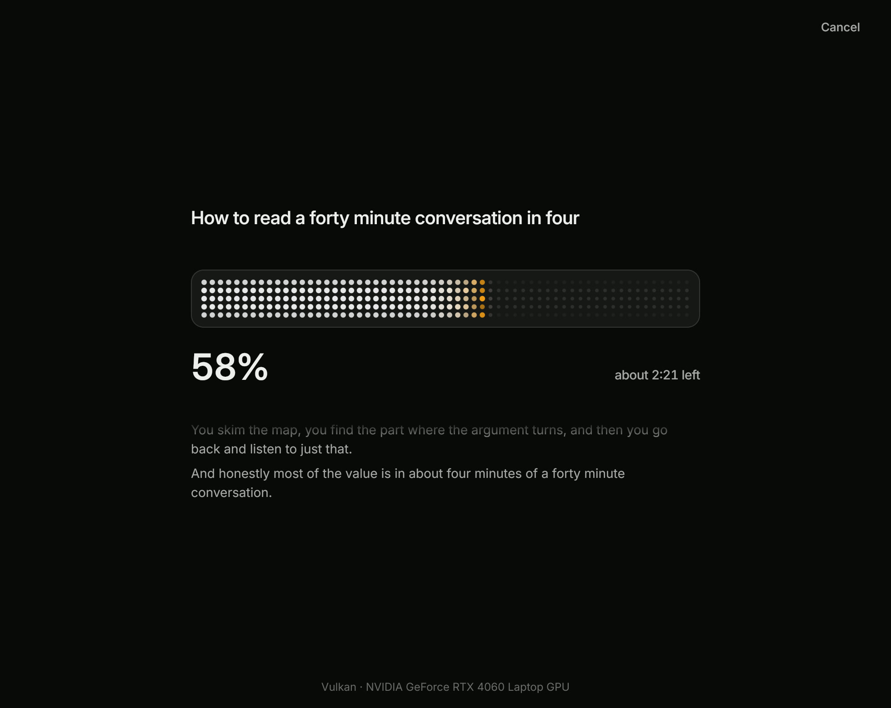
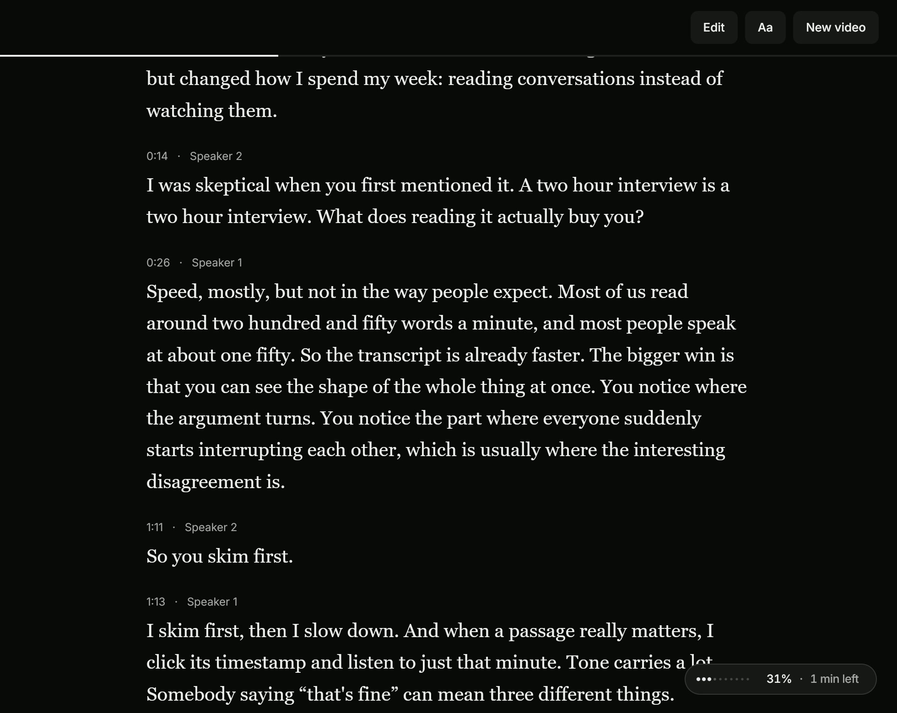

<p align="center">
  
</p>

<h1 align="center">Vellum</h1>

<p align="center">
  <b>Read any video.</b> Paste a YouTube link and get a clean, readable transcript, transcribed on your own machine.
</p>

<p align="center">
  
  
</p>

Vellum is a native desktop app written in Rust with [Rune](https://github.com/anomalyco/rune). It reads a video's captions, or downloads its audio and transcribes it locally with Parakeet or Whisper, optionally labelling speakers.

- **Local speech recognition.** Parakeet Unified English, Whisper Small and Whisper Large v3 Turbo through [transcribe.cpp](https://crates.io/crates/transcribe-cpp), on Vulkan, Metal or the CPU. No Python, nothing uploaded.
- **Speaker labels.** Vellum can tell voices apart and label each speaker's turns.
- **One progress indicator.** A plate of dots fills as the transcript is made, with the percentage, the time left and the words as they're recognized.
- **Reading progress.** A hairline along the top fills as you read, and the toolbar shows how far you are and the time left at your reading pace, which Vellum learns from how you scroll and remembers.
- **Made for reading.** One continuous page; serif, sans or mono; adjustable size, width and spacing; timestamps open the video at that moment.

## Install and run

Vellum uses the standalone [yt-dlp](https://github.com/yt-dlp/yt-dlp/releases) executable with Node.js 22+ or Deno for YouTube extraction, and FFmpeg for audio. It finds yt-dlp and FFmpeg beside its executable or on `PATH`. On macOS it also checks the Homebrew directories when launched from Finder.

Building from source requires Rust 1.99.1 or newer, CMake and a C++ compiler:

- **Windows:** Visual Studio C++ build tools and the Windows SDK.
- **Windows and Linux:** Vulkan headers and shader tools, for the optional GPU backend.
- **macOS:** Xcode with the Metal toolchain.

```sh
cargo run --release --locked
```

When you move a build, keep the native libraries with it: the DLLs beside `vellum.exe` on Windows, or the `vellum-libs/` directory beside `vellum` on Linux.

| Desktop | Speech acceleration | Display |
| --- | --- | --- |
| Windows | Vulkan or CPU | Direct3D 12 |
| Linux | Vulkan or CPU | A graphical session with a Vulkan driver, hardware or software |
| macOS | Metal or CPU | A Metal-capable Mac |

## Using Vellum

On first launch, choose a speech model. Parakeet Unified English (731 MB) is the English default. Whisper Small (270 MB) and Whisper Large v3 Turbo (886 MB) handle many languages. The model starts downloading in the background while you continue. **Skip** reads YouTube captions instead.

Paste a link and press **Transcribe**. When the video has its uploader's own captions, Vellum uses them, which takes seconds; otherwise it transcribes the audio with your speech model. The model button in the top right switches models or chooses YouTube captions, automatic ones included. **Label speakers** adds speaker turns.

In the reader, **Aa** changes the typeface, size, reading width, line spacing and timestamps. The toolbar shows how far you are and how long is left at your reading pace.

| Keys | Action |
| --- | --- |
| Space / Shift+Space | Page down / up |
| Home / End | Glide to the top / end |
| Ctrl + mouse wheel | Text size |
| Esc | Cancel a transcription, or close **Aa** |

Speech recognition uses your GPU when it can and falls back to the CPU otherwise; set `TRANSCRIBE_BACKENDS=cpu` to always use the CPU. Downloaded audio is deleted once the transcript is ready. Models are kept in the Hugging Face cache, so other apps that use it can share them.

## Development

```sh
cargo test --locked
```

See [tests/README.md](tests/README.md) for the optional tests that transcribe real videos.

## License

[MIT](LICENSE)
